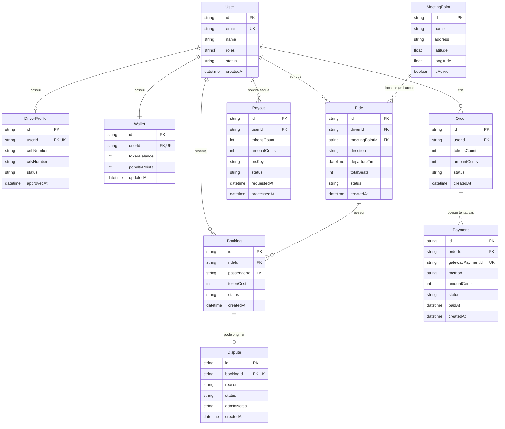

# Architecture / Software Design Document

**Projeto:** UTFgo
**Versão do documento:** 1.0.0 — revisão em andamento
**Última atualização:** 2026-10-10

O PRD define o produto; este documento define a estrutura do projeto e seus nomes técnicos. Esta revisão segue o enunciado da Atividade 06 fornecido pela equipe. O app será gerado na Atividade 07, após a revisão humana deste documento.

## 1. Fontes de contexto para a IA

| Fonte | Local | Responsabilidade |
| :--- | :--- | :--- |
| Requisitos | `docs/prd.md` | Glossário, atores e regras de negócio |
| Design | `docs/design-tokens.md` | Tokens, breakpoints, identidade PWA e referências do protótipo |
| Protótipo | [Figma UTFgo](https://www.figma.com/design/2eDxEEIwGE3I8OCTHEuSPO/UTFgo?node-id=51-13) | Telas consultadas em 2026-10-10; referência para rotas e componentes |
| Constituição | `.agents/rules/utf-rules.md`, referenciada por `CLAUDE.md` | Método, decisões humanas e limites dos agentes |
| Workflows | `.agents/workflows/` | Entrevistas e ciclos do método |
| Agentes | `.agents/agents/`, com adaptadores em `.claude/agents/` | Implementação, revisão, auditoria e tutoria |

**Pendência de contexto:** o checklist e os workflows deste checkout ainda descrevem NestJS/Prisma e GitHub Flow pela `main`. A Atividade 06 fornecida pela equipe exige Angular, json-server/BaaS, npm workspaces e Gitflow pela `develop`. Antes do `/utf-setup`, a equipe deve obter e conferir o template oficial correspondente. O `AGENTS.md` citado pelo enunciado não existe neste checkout; esta revisão não cria nem substitui esse arquivo.

## 2. Stack tecnológica e padrões

- **Frontend:** Angular 22+, com TypeScript na faixa compatível com a linha escolhida.
- **Ambiente:** Node.js LTS compatível com Angular; npm como gerenciador.
- **Estilo:** Tailwind CSS 4+, usando cores, tipografia, espaçamentos e breakpoints de `docs/design-tokens.md`. Integração com Angular por `@tailwindcss/postcss` da mesma linha e `postcss`. Essas dependências foram aprovadas pela equipe; serão instaladas na Atividade 07, com versões exatas no manifesto e no lockfile.
- **Dados — Entrega 2:** json-server, com dados simulados em `mocks/db.json` na raiz.
- **Dados — Entrega 3:** BaaS; fornecedor e SDK adiados para essa entrega.
- **Backend próprio:** `apps/api` é somente um lugar reservado; ficará vazio durante o semestre, conforme o enunciado.
- **Monorepo:** npm workspaces, com declaração das aplicações existentes no `package.json` da raiz. A pasta reservada `apps/api` não terá pacote ou scripts executáveis.
- **Testes:** Vitest, padrão do gerador Angular. Testes pelo comando `npm test` na raiz; lint pelo comando `npm run lint` na raiz. A configuração do lint será feita pelo `/utf-setup` na Atividade 07.

Nenhuma dependência escolhida pela equipe entra sem declaração neste documento. Dependências padrão do gerador serão ratificadas no setup. As versões exatas ficam no `package.json` e no lockfile, criados na Atividade 07.

Os scripts da raiz devem encaminhar os comandos ao workspace `apps/web`: `npm test` executa a suíte Angular com `ng test --watch=false`, e `npm run lint` executa `ng lint` após a configuração do linter no setup. A pasta reservada `apps/api` não participa desses comandos.

### 2.1. Padrões Angular

- Componentes standalone, sem declaração redundante de `standalone: true`.
- Estado de interface com `signal()` e valores derivados com `computed()`; `effect()` somente quando houver efeito necessário.
- Templates com `@if`, `@for` e `@switch`.
- Entradas e saídas com `input()` e `output()`.
- Injeção de dependências com `inject()`.
- Lazy loading por feature, com `loadComponent` ou `loadChildren`.
- Formulários reativos com `ReactiveFormsModule`, `FormControl` e `FormGroup`, usando validadores e mensagens de erro. Regras específicas de cada formulário pertencem à spec da história.
- Interceptors funcionais em `core/interceptors/` para tratamento centralizado de erros HTTP. A integração da autenticação ocorrerá na Entrega 3.
- Interoperabilidade RxJS/signals com `toSignal()` e `toObservable()` quando necessária, sem biblioteca adicional de estado. A conversão não deve recriar assinaturas a cada renderização.

### 2.2. Camada de dados

**Componente não fala com o servidor.** Somente Services de dados em `core/services/` acessam a fonte de dados. Componentes não injetam `HttpClient`, não chamam `fetch` e não usam diretamente o SDK do futuro BaaS.

Os Services traduzem os dados da fonte para os modelos da aplicação. Assim, a migração para o BaaS troca a implementação de acesso a dados, preservando os contratos consumidos pelas telas. Ajustes de comportamento exigidos pela autenticação real serão definidos nas specs correspondentes.

### 2.3. Autenticação e decisões adiadas

O PRD mantém OTP por e-mail institucional e JWT como requisitos. Na Entrega 2, a sessão será simulada, sem autenticação real. Na Entrega 3, a equipe decidirá o BaaS, a configuração de OTP, o armazenamento e a renovação dos tokens e as regras de acesso no servidor.

Guards do frontend controlam a navegação; não substituem a autorização no servidor. O json-server não possui autenticação, propriedade de registros ou validação de negócio. Essas limitações devem ser tratadas na migração, sem apresentar a simulação como segurança real.

### 2.4. Referências técnicas consultadas

O Context7 não está disponível nesta sessão; as referências foram conferidas diretamente na documentação oficial. Isso não comprova o teste de vida do Context7 solicitado à equipe pela atividade.

- [Compatibilidade Angular/Node.js/TypeScript/RxJS](https://angular.dev/reference/versions)
- [Testes no Angular](https://angular.dev/guide/testing)
- [Formulários reativos](https://angular.dev/guide/forms/reactive-forms)
- [Interceptors funcionais](https://angular.dev/guide/http/interceptors)
- [Interoperabilidade RxJS e signals](https://angular.dev/ecosystem/rxjs-interop)
- [Integração Tailwind com Angular](https://tailwindcss.com/docs/installation/framework-guides/angular)

## 3. Estrutura do repositório

A árvore abaixo é um contrato para o desenvolvimento. Pastas de domínio serão criadas somente quando uma história precisar delas. Esta atividade não cria aplicações, pastas de features ou arquivos de configuração executáveis.

```text
.
├── .agents/                   # Constituição, workflows e prompts
├── .claude/                   # Adaptadores do harness
├── CLAUDE.md                   # Referência à constituição
├── README.md
├── docs/                      # Requisitos, arquitetura e design
├── specs/                     # Specs, planos e pareceres das histórias
├── package.json               # Futuro: npm workspaces e scripts da raiz
├── mocks/
│   └── db.json                # Futuro: dados simulados da Entrega 2
└── apps/
    ├── api/                   # Reservada e vazia
    └── web/
        └── src/
            ├── environments/  # Endereços e configuração pública
            └── app/
                ├── core/
                │   ├── services/      # Acesso a dados
                │   ├── guards/        # Controle de navegação
                │   └── interceptors/  # Tratamento HTTP transversal
                ├── shared/            # Componentes de apresentação e pipes
                └── features/          # Telas organizadas por domínio
```

## 4. Arquitetura frontend

### 4.1. Responsabilidades e importações

- `core/` reúne Services de dados, guards e interceptors. Não importa telas ou componentes de `features/`.
- `shared/` reúne componentes reutilizáveis de apresentação e pipes. Seus componentes recebem dados e emitem eventos, sem buscar dados no servidor. Não importa `features/`.
- `features/` reúne telas e componentes exclusivos de cada domínio. Pode importar `core/` e `shared/`, mas uma feature não importa outra.
- Um componente usado por mais de uma feature vai para `shared/`; acesso a dados compartilhado permanece em `core/services/`.
- Dados e código usam inglês; a interface usa português.

### 4.2. Roteamento planejado

O mapa abaixo foi aprovado pela equipe após a consulta ao Figma em 2026-10-10. São rotas planejadas do frontend, sem implementação nesta atividade. O arquivo principal `app.routes.ts` encaminhará para as features com `loadComponent` ou `loadChildren`; as páginas serão carregadas por lazy loading quando a pessoa acessar cada rota. O §6 permanece reservado às histórias efetivamente implementadas.

| Rota planejada | Tela ou fluxo do protótipo | Acesso previsto conforme PRD |
| :--- | :--- | :--- |
| `/` | Página institucional | Público |
| `/entrar` | E-mail institucional | Público |
| `/entrar/codigo` | Verificação por código | Público, etapa de entrada |
| `/inicio` | Início conforme o papel do usuário | Sessão de usuário |
| `/caronas` | Busca de caronas | Passageiro com sessão |
| `/caronas/:id/reservar` | Confirmação da solicitação de reserva | Passageiro com sessão |
| `/condutor/caronas` | Publicação e listagem de caronas oferecidas | Condutor homologado com sessão |
| `/condutor/caronas/:id` | Gestão da carona e dos passageiros | Condutor responsável pela carona, com sessão |
| `/carteira` | Saldo e extrato | Sessão de passageiro ou condutor |
| `/carteira/comprar` | Compra de fichas e etapas do pagamento | Sessão de passageiro ou condutor |

As condições de acesso orientam os futuros guards em `core/guards/`. Na Entrega 2, a sessão e os papéis serão simulados; a autorização efetiva no servidor será definida com o BaaS na Entrega 3. Controle de propriedade de carona não pode depender somente de um guard do frontend.

As versões vazia e preenchida do início e da listagem são estados da mesma página. Quantidade de fichas, método de pagamento, código Pix e resultado são etapas do fluxo `/carteira/comprar`, sem rotas separadas neste mapa. Detalhes de transição, validação e comportamento de cada etapa pertencem à spec da história.

Referências visuais consultadas: página institucional (`260:394`), login e código (`133:1716`, `133:1756`), início do passageiro (`133:2256`, `133:2475`), busca (`133:2352`), confirmação de reserva (`295:561`), início do condutor (`248:442`, `248:538`), publicação/listagem (`248:684`, `248:769`, `248:895`), gestão de passageiros (`248:1067`), carteiras (`133:2146`, `248:332`) e compra/pagamento (`133:1822`, `248:241`, `133:1913`, `133:1978`, `133:2032`, `133:2089`).

O item Perfil aparece na navegação, mas uma tela correspondente não foi identificada nos frames nomeados consultados. Não foi criada uma rota para esse item.

### 4.3. Componentes compartilhados

O mapa abaixo foi aprovado pela equipe a partir dos elementos repetidos no protótipo. Os componentes pertencem a `shared/`, recebem dados por `input()` e comunicam ações por `output()`. Não injetam Services de dados, `HttpClient` ou SDK do BaaS. As telas em `features/` coordenam as ações com os Services de `core/`.

| Componente (EN) | Responsabilidade | Uso no protótipo |
| :--- | :--- | :--- |
| `RideCard` | Apresentar informações da carona e emitir ações solicitadas pela tela | Busca, confirmação de reserva, início e caronas do condutor |
| `UserIdentity` | Apresentar nome, foto e informações públicas fornecidas pela tela | Identificação do condutor e dos passageiros |
| `AppNavigation` | Apresentar opções de navegação recebidas e indicar a opção ativa | Navegação recorrente das telas de passageiro e condutor |
| `StatusBadge` | Apresentar rótulo e estilo de um estado recebido | Indicadores de situação da carona e do pagamento |

As diferenças visuais entre contextos serão expressas pelas entradas e pela composição dos componentes, sem buscar dados ou decidir permissões dentro deles. Um componente exclusivo de uma tela permanece na respectiva feature. Os arquivos serão criados somente nas histórias que precisarem deles; nesta atividade fica registrado apenas o mapa.

## 5. Arquitetura de dados

**Modelo em revisão:** os nomes do glossário, a representação de papéis, vagas, fichas e sentido e as cardinalidades foram aprovados na entrevista. Os demais atributos da proposta original ainda serão conferidos na leitura final pela equipe. O conjunto não é um schema aprovado para geração de código. A materialização no BaaS ocorrerá na Entrega 3; estados e transições específicos de histórias serão definidos nas specs correspondentes.

### 📖 5.1. Glossário Técnico (Mapeamento PRD §2 → Entidades)

> Código, atributos e entidades em inglês; interface e termos negociais em português.

| Termo PRD (PT-BR) | Entidade Técnica (EN) | Atributos Principais |
| :---------------- | :-------------------- | :------------------- |
| **Usuário** | `User` | `id`, `email`, `name`, `roles` (coleção de `PASSENGER`, `DRIVER`, `ADMIN`), `status` (`ACTIVE`, `SUSPENDED`, `BANNED`), `createdAt` |
| **Administrador** | `User` com papel `ADMIN` | Identidade em `User`; permissões conforme PRD §3 |
| **Passageiro** | `User` com papel `PASSENGER` | Identidade em `User`; referências por `Booking.passengerId` |
| **Condutor** | `User` com papéis `PASSENGER` e `DRIVER`, associado a `DriverProfile` aprovado | Identidade em `User`, homologação em `DriverProfile`; referências por `Ride.driverId` |
| **Perfil de Condutor** | `DriverProfile` | `id`, `userId`, `cnhNumber`, `crlvNumber`, `status` (`PENDING`, `APPROVED`, `REJECTED`), `approvedAt` |
| **Carteira** | `Wallet` | `id`, `userId`, `tokenBalance`, `penaltyPoints`, `updatedAt` |
| **Ficha** | `Token` (unidade de crédito, sem entidade individual) | Saldo em `Wallet.tokenBalance`, quantidade comprada em `Order.tokensCount`, custo em `Booking.tokenCost` e quantidade de saque em `Payout.tokensCount` |
| **Pedido de Fichas** | `Order` | `id`, `userId`, `tokensCount`, `amountCents`, `status` (`PENDING`, `COMPLETED`, `CANCELLED`), `createdAt` |
| **Pagamento (Gateway)** | `Payment` | `id`, `orderId`, `gatewayPaymentId`, `method` (`PIX`, `CREDIT_CARD`), `amountCents`, `status` (`PENDING`, `PAID`, `FAILED`, `REFUNDED`), `paidAt` |
| **Saque Condutor** | `Payout` | `id`, `userId`, `tokensCount`, `amountCents`, `pixKey`, `status` (`PENDING`, `COMPLETED`, `REJECTED`), `requestedAt`, `processedAt` |
| **Ponto de Encontro** | `MeetingPoint` | `id`, `name`, `address`, `latitude`, `longitude`, `isActive`, `createdAt` |
| **Carona** | `Ride` | `id`, `driverId`, `meetingPointId`, `direction` (`TO_CAMPUS`, `FROM_CAMPUS`), `departureTime`, `totalSeats`, `status` (`SCHEDULED`, `IN_PROGRESS`, `COMPLETED`, `CANCELLED`, `EXPIRED`) |
| **Sentido** | `Ride.direction` | `TO_CAMPUS` (ida ao campus) e `FROM_CAMPUS` (volta do campus) |
| **Vaga** | Capacidade em `Ride.totalSeats`; disponibilidade em `Ride.availableSeats` (calculada) | `totalSeats` e reservas que ocupam assentos; sem entidade `Seat` |
| **Reserva** | `Booking` | `id`, `rideId`, `passengerId`, `tokenCost`, `status` (`PENDING`, `CONFIRMED`, `CANCELLED`, `COMPLETED`, `NO_SHOW`), `createdAt` |
| **Contestação** | `Dispute` | `id`, `bookingId`, `reason`, `status` (`OPEN`, `RESOLVED_REFUND`, `DISMISSED`), `adminNotes`, `createdAt` |

**Papéis aprovados:** `User.roles` permite representar passageiro e condutor na mesma conta. `DriverProfile` guarda a homologação; possuir o papel `DRIVER` não substitui a aprovação do perfil. Os papéis não removem as restrições do PRD, inclusive a proibição de o administrador participar de caronas. Na Entrega 2, os papéis serão simulados como coleção no JSON; a persistência e a autorização efetiva serão definidas com o BaaS na Entrega 3.

**Vagas aprovadas:** `Ride.totalSeats` guarda a capacidade ofertada. `Ride.availableSeats` é calculado como capacidade menos as reservas que ocupam assentos; não é um campo persistido nem uma entidade `Seat`. A spec da história de reservas definirá quais estados ocupam uma vaga e como evitar disputa pelo mesmo assento.

**Fichas aprovadas:** `Token` é o nome técnico da unidade de crédito. As fichas são representadas por quantidades nos campos do glossário, sem uma entidade para cada unidade. Esse conceito é distinto do token JWT de autenticação. Valores monetários ficam em campos como `amountCents`; conversão, movimentações, retenção e estorno serão detalhados nas specs correspondentes.

**Sentido aprovado:** `Ride.direction` usa `TO_CAMPUS` para ida ao campus e `FROM_CAMPUS` para volta do campus; não há entidade separada para o sentido.

O passageiro da contestação é acessado via `Dispute -> Booking -> passengerId`, evitando redundâncias.

**Relações aprovadas:** cada usuário tem uma carteira e pode ter um perfil de condutor. Pode criar vários pedidos e saques, conduzir várias caronas e fazer várias reservas. Cada pedido pode ter várias tentativas de pagamento. Cada ponto de encontro pode ser usado em várias caronas; cada carona pode receber várias reservas; cada reserva pode originar no máximo uma contestação. As relações 1:1 exigem unicidade de `Wallet.userId`, `DriverProfile.userId` e `Dispute.bookingId` na futura persistência. As referências `Ride.driverId` e `Booking.passengerId` apontam para `User.id`.

### 📊 5.2. Diagrama ER (Mermaid)



### 5.3. Ambientes e segredos

| Ambiente/fase | Fonte de dados | Configuração |
| :--- | :--- | :--- |
| Local — Entrega 2 | json-server servindo `mocks/db.json` | Endereço público da API em `apps/web/src/environments/` |
| Testes | Dados simulados e isolamento das chamadas HTTP | Configuração de testes pelo setup; sem depender de BaaS ou credenciais reais |
| Entrega 3 | BaaS a definir pela equipe | Endereço e eventual chave pública no frontend; regras de acesso no servidor |

O frontend é entregue ao navegador: arquivos de environment não escondem segredos. Eles guardam endereços e configuração pública. Uma chave pública do BaaS só pode entrar quando o fornecedor a destinar ao navegador, acompanhada das regras de acesso no servidor. Chaves secretas de BaaS, pagamento ou e-mail ficam exclusivamente no ambiente de servidor, fora do Git e do pacote frontend.

O endereço da fonte de dados será exposto como `apiUrl` nos arquivos de environment em `apps/web/src/environments/`. Somente a camada de dados lê essa configuração para acessar a fonte; nenhuma credencial secreta entra nesses arquivos.

Os dados simulados devem ser fictícios. A escolha de hospedagem, a configuração do BaaS e os mecanismos de servidor para pagamentos e regras sensíveis serão definidos na Entrega 3.

## 6. Mapa de domínios e rotas implementados

Este índice cresce uma linha por história implementada. Permanece vazio na Atividade 06.

| Domínio | Rota | Guard | Dados (Service) | US |
| :--- | :--- | :--- | :--- | :--- |

## 7. Histórico

| Data | Versão | O que mudou |
| :--- | :--- | :--- |
| 2026-10-02 | 1.0.0 | Proposta inicial de arquitetura na branch `chore/arquitetura`; revisão humana em andamento. |

## Pendências para concluir a revisão

- Conferir os atributos restantes do modelo na leitura final; os dez termos do glossário do PRD e as cardinalidades já foram revisados com a equipe.
- Conferir o template oficial da disciplina antes do setup, diante das divergências de stack e fluxo Git nos arquivos de contexto.
- A equipe ler o documento, realizar a tutoria de arquitetura, escrever a explicação do PR e fazer seu commit; a entrega exige o PR mesclado na `develop`.
